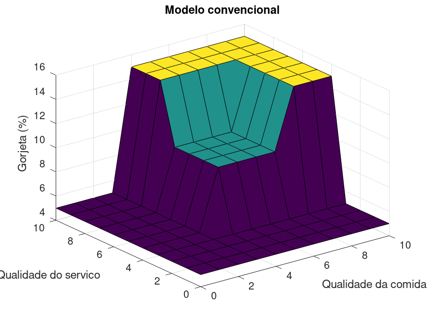
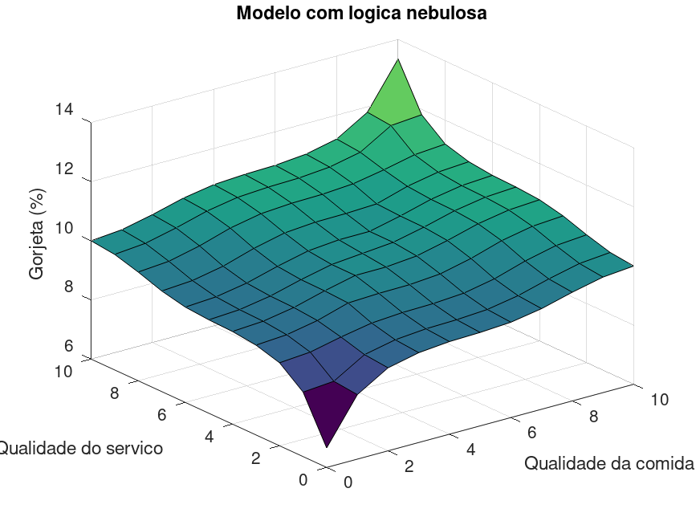

# Fundamentos da Inteligência Artificial

Atividades práticas de **Fundamentos da Inteligência Artificial**, explorando lógica nebulosa no GNU Octave e uma rede neural simples em Python.

## Atividades

### U3 — Lógica Nebulosa

Implementação de dois modelos para calcular a porcentagem de gorjeta com base na qualidade da comida e do atendimento (notas de 0 a 10):

- **Convencional:** decisões por faixas fixas, com gorjetas de 5%, 10% ou 15%.
- **Nebuloso:** funções de pertinência, regras fuzzy e defuzzificação para obter resultados graduais.

**Modelo convencional**



**Modelo com lógica nebulosa**



### U4 — Redes Neurais Artificiais

Implementação em Python de uma rede neural de uma camada para classificação binária (operação lógica AND), com função de ativação sigmoide, aprendizado supervisionado e **10.000 épocas** de treinamento.

## Estrutura do projeto

```text
Fundamentos-AI/
├── U3-Logica-Nebulosa/
│   └── gorgeta.m
├── U4-Redes-Neurais/
│   └── rede_neural.py
├── LICENSE
├── modelo_convencional.png
├── modelo_nebuloso.png
└── README.md
```

## Como executar

### Lógica Nebulosa — GNU Octave

Na raiz do repositório:

```bash
octave U3-Logica-Nebulosa/gorgeta.m
```

O programa imprime comparações de gorjetas e gera os gráficos `modelo_convencional.png` e `modelo_nebuloso.png` no diretório de execução.

### Rede Neural — Python

Com Python 3 instalado, na raiz do repositório:

```bash
python3 -m venv .venv
source .venv/bin/activate
python -m pip install numpy
python U4-Redes-Neurais/rede_neural.py
```

O programa exibe a evolução do erro, os pesos finais, as previsões e a acurácia no conjunto de treinamento.

> **Importante:** mantenha `README.md` e os dois arquivos `.png` na raiz do repositório para que o GitHub exiba as imagens corretamente.

## Licença

Projeto acadêmico distribuído sob a [Licença MIT](./LICENSE). O uso do material
é livre, inclusive para fins didáticos, desde que mantida a atribuição ao autor.
